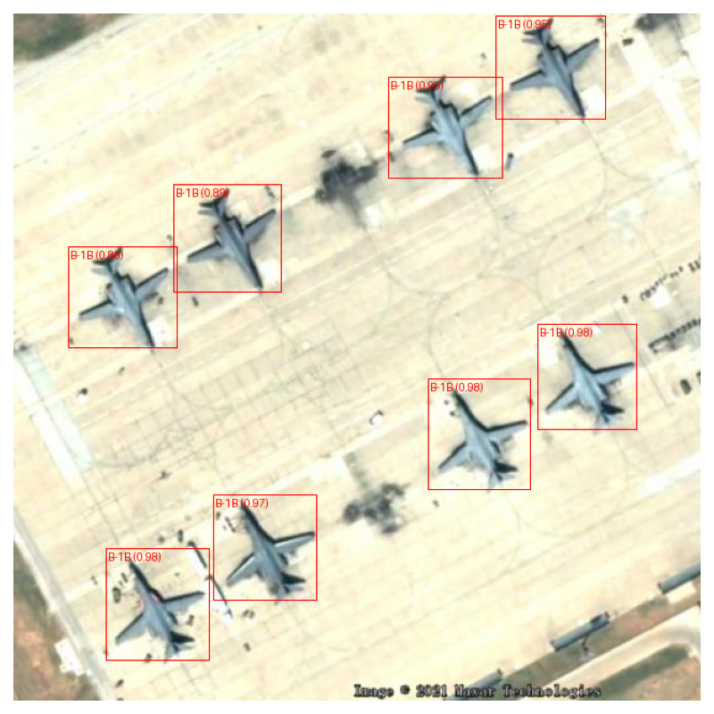
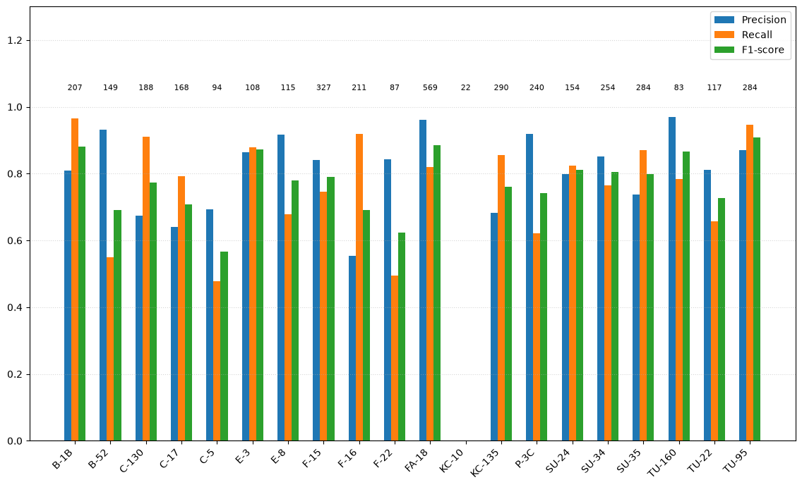
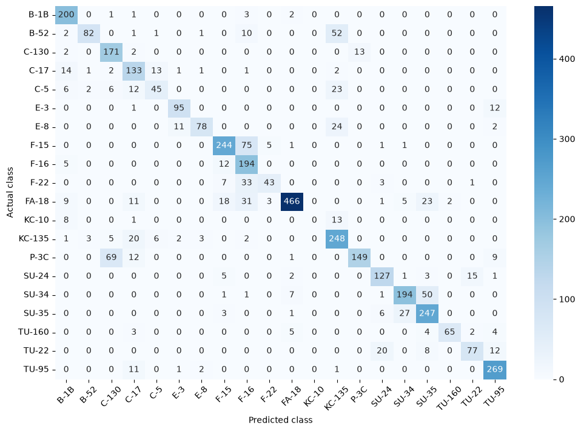

# Example output

# My training results

Classification report:

Confusion matrix:

Model summary:
| Metric             | Value  |
| ------------------ | ------ |
| Overall accuracy   | 0.7914 |
| Macro precision    | 0.7684 |
| Macro recall       | 0.7278 |
| Macro F1 score     | 0.7339 |
| Weighted precision | 0.8116 |
| Weighted recall    | 0.7914 |
| Weighted F1 score  | 0.7891 |